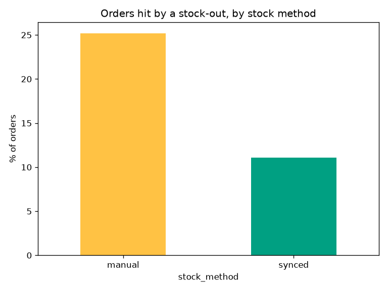
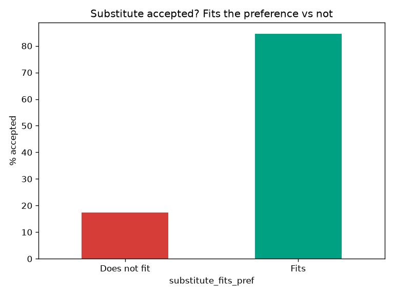

# Shelf Sync: stock-outs and substitutions in grocery delivery

When a delivery app sells an item the store no longer has, the store can reject the order (a lost sale) or send a
substitute (a sale kept, but often refunded and rated badly). This project looks at where those orders go wrong,
what they cost, and three fixes: **live stock sync**, **low-stock alerts** and **substitutes that match what the
customer wants** (vegan for vegan).

It started from a real result: on a UK retailer's delivery-app orders, stopping stores from rejecting orders cut
unfulfilled orders from 4% to 0.9%, but substitutions rose and ratings dropped. The fix belongs upstream.

**Video walkthrough (4 min):** https://share.descript.com/view/YYOH8REKvTl

## What's inside

| Folder | What it is |
|---|---|
| [`notebooks/01_stockout_analysis.ipynb`](notebooks/01_stockout_analysis.ipynb) | The analysis in Python (pandas, Matplotlib): how often orders hit a stock-out, when and where, what happens next, what it costs, and a what-if estimate for each fix |
| [`specs/001-stockout-substitutes/spec.md`](specs/001-stockout-substitutes/spec.md) | The spec, written before the code: why, who, Given/When/Then scenarios, FR-001–FR-005, success and kill criteria |
| [`shelfsync/`](shelfsync/) · [`tests/`](tests/) | Tested Python functions: substitute ranking (vegan for vegan) and the stock-out metrics. Tests were committed first (red), then the code (green): `python -m pytest -q` |
| [`docs/adr/`](docs/adr/) · [`research/ledger.csv`](research/ledger.csv) | Decision records, and an evidence ledger where every number has a source, date and kind |
| [`data/`](data/) | `generate_data.py` creates the **synthetic** dataset `order_lines.csv` (4 weeks, 8 Barcelona stores, 5,433 orders) |
| [`docs/`](docs/) | The project PRD (problem statement, scope, process diagrams, decision log, research log) |
| [`prototype/shelf-sync.html`](prototype/shelf-sync.html) | Interactive concept prototype: customer app and store tablet with the three fixes as switches, plus a 300-order simulator. Open it in any browser |
| [`simulation/`](simulation/) | Directive and four fictional personas for simulated-user critique waves (DS403 method) |
| [`research/`](research/) | Company and competitor research (store-side tools at Glovo, Just Eat, Deliveroo, Uber Eats) and handwritten field notes |

## Key findings (synthetic data)

| Finding | Number |
|---|---|
| Orders with at least one out-of-stock item | 18.0% |
| Stores that update stock by hand vs synced stock | 25.2% vs 11.1% of orders hit |
| Evenings (19:00+) vs earlier | 23.4% vs 15.1% |
| Substitute accepted when it fits the customer's preference vs not | 84.6% vs 17.3% |
| Average rating, orders with a refund vs without | 3.23 vs 4.52 |
| Ordered again within 14 days, refund vs no refund | 71.9% vs 87.1% |




**Important:** the data is made up with simple, stated rules (see `data/generate_data.py`), so these numbers show the
method, not real company figures. The next step is to rerun the notebook on real data (Instacart or Olist from Kaggle)
and design an A/B test for each fix.

## Run it yourself

```bash
pip install -r requirements.txt
cd data && python generate_data.py && cd ..
python -m pytest -q
jupyter notebook notebooks/01_stockout_analysis.ipynb
```

## About

Built by MD Monajir Hussain, product and data analyst, studying data science at Harbour.Space (Barcelona).
Concept work for a proposal; not affiliated with any delivery company.
